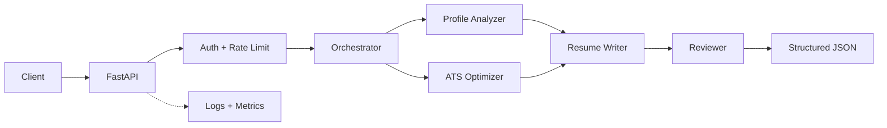

# Enterprise AI Resume Generator Agent

[](https://github.com/AnkyAI/enterprise-ai-resume-agent/actions/workflows/ci.yml)
[](https://www.python.org/)
[](https://fastapi.tiangolo.com/)
[](LICENSE)

A secure, observable, production-style multi-agent workflow that analyzes a candidate profile, evaluates ATS alignment, writes structured resume content, and performs a final quality review. It supports a free local Ollama LLM with a deterministic offline fallback, so no paid API is required.

## Why this is more than a chatbot

- Four agents with isolated, typed responsibilities
- FastAPI service with strict request and response contracts
- Constant-time API-key authentication and configurable rate limits
- Safe error envelopes, payload limits, and security headers
- Structured JSON logs, request correlation, and Prometheus metrics
- Reproducible tests, container hardening, CI, and deployment readiness
- Optional schema-constrained Ollama generation with explicit fallback reporting

## Architecture



See [Architecture](docs/ARCHITECTURE.md) and [Security](docs/SECURITY.md) for design decisions, threat controls, and the production scaling path.

## Quick start

```bash
python3.12 -m venv .venv
source .venv/bin/activate
python -m pip install -e '.[dev]'
cp .env.example .env
uvicorn resume_agent.api:app --reload
```

The API is available at `http://localhost:8000`; interactive documentation is at `/docs` outside production.

Generate a resume:

```bash
curl --fail-with-body \
  -H 'Content-Type: application/json' \
  -H 'X-API-Key: dev-secret-key' \
  --data @examples/request.json \
  http://localhost:8000/v1/resumes/generate
```

Every success response contains `profile_analysis`, `ats_analysis`, `resume`, `review`, and pipeline `metadata`. Use the returned `request_id` to correlate client activity with server logs.

## Free local AI with Ollama

The default deterministic provider keeps setup and CI lightweight. To generate resume content with a real local LLM, install [Ollama](https://ollama.com/), then run:

```bash
ollama pull llama3.2:3b
ollama serve
```

Set these values in `.env` and restart the API:

```dotenv
RESUME_AI_PROVIDER=ollama
RESUME_OLLAMA_MODEL=llama3.2:3b
RESUME_OLLAMA_BASE_URL=http://127.0.0.1:11434
RESUME_ALLOW_DETERMINISTIC_FALLBACK=true
```

Ollama receives the complete writing context and a JSON Schema generated from `ResumeContent`. Its output is validated again before entering the reviewer agent. If Ollama is unavailable or produces invalid output, the service uses the deterministic writer when fallback is enabled and reports `fallback_used: true` in response metadata.

When the API runs inside Docker Desktop and Ollama runs on the host, set `RESUME_OLLAMA_BASE_URL=http://host.docker.internal:11434`.

## API endpoints

| Method | Path | Authentication | Purpose |
|---|---|---:|---|
| `POST` | `/v1/resumes/generate` | Required | Execute the four-agent pipeline |
| `GET` | `/health` | Public | Liveness check |
| `GET` | `/ready` | Public | Readiness check |
| `GET` | `/metrics` | Public* | Prometheus metrics |

*Restrict `/metrics` to the internal network at the production ingress.

## Docker

```bash
cp .env.example .env
docker compose up --build
```

The container runs as a non-root user. Compose drops Linux capabilities and mounts the root filesystem read-only.

## Quality gates

```bash
make check
```

This runs Ruff lint/format checks, strict MyPy analysis, and pytest with coverage. GitHub Actions repeats the checks and builds the production container for every pull request.

## Repository map

```text
src/resume_agent/
├── agents/          # One module per workflow agent
├── api.py           # Routes, middleware, errors, operations endpoints
├── config.py        # Validated environment configuration
├── models.py        # Strict public and internal schemas
├── orchestrator.py  # Pipeline sequencing, provider fallback, telemetry
├── providers/       # Free local Ollama provider boundary
└── security.py      # Authentication and rate limiting
tests/               # API, security, and agent behavior tests
docs/                # Architecture and threat model
examples/            # Ready-to-run request payload
```

## Production evolution

The deterministic provider keeps demos and CI fast, reproducible, private, and free. The Ollama adapter adds real local LLM generation with timeouts and JSON Schema output. Additional providers can implement the same `ResumeGenerationProvider` contract while retaining the validated domain models.

Before a multi-instance deployment, replace the in-memory rate limiter with Redis or API-gateway enforcement and replace shared API keys with OAuth2/OIDC.

## Responsible use

The system must not invent credentials, employment, or metrics. Missing ATS keywords are recommendations, not facts to insert. Candidate PII requires access control, retention limits, encryption, and applicable privacy-law review.

## License

MIT

