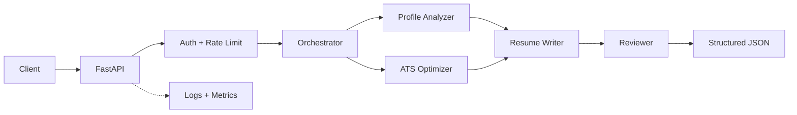

# Enterprise AI Resume Generator Agent

[](https://github.com/AnkyAI/enterprise-ai-resume-agent/actions/workflows/ci.yml)
[](https://www.python.org/)
[](https://fastapi.tiangolo.com/)
[](LICENSE)

A secure, observable, production-style multi-agent workflow that analyzes a candidate profile, evaluates ATS alignment, writes structured resume content, and performs a final quality review. It runs locally without paid APIs and exposes clean extension points for an enterprise LLM provider.

## Why this is more than a chatbot

- Four agents with isolated, typed responsibilities
- FastAPI service with strict request and response contracts
- Constant-time API-key authentication and configurable rate limits
- Safe error envelopes, payload limits, and security headers
- Structured JSON logs, request correlation, and Prometheus metrics
- Reproducible tests, container hardening, CI, and deployment readiness

## Architecture



See [Architecture](docs/ARCHITECTURE.md) and [Security](docs/SECURITY.md) for design decisions, threat controls, and the production scaling path.

## Quick start

```bash
python3.12 -m venv .venv
source .venv/bin/activate
python -m pip install -e '.[dev]'
cp .env.example .env
uvicorn resume_agent.api:app --reload
```

The API is available at `http://localhost:8000`; interactive documentation is at `/docs` outside production.

Generate a resume:

```bash
curl --fail-with-body \
  -H 'Content-Type: application/json' \
  -H 'X-API-Key: dev-secret-key' \
  --data @examples/request.json \
  http://localhost:8000/v1/resumes/generate
```

Every success response contains `profile_analysis`, `ats_analysis`, `resume`, `review`, and pipeline `metadata`. Use the returned `request_id` to correlate client activity with server logs.

## API endpoints

| Method | Path | Authentication | Purpose |
|---|---|---:|---|
| `POST` | `/v1/resumes/generate` | Required | Execute the four-agent pipeline |
| `GET` | `/health` | Public | Liveness check |
| `GET` | `/ready` | Public | Readiness check |
| `GET` | `/metrics` | Public* | Prometheus metrics |

*Restrict `/metrics` to the internal network at the production ingress.

## Docker

```bash
cp .env.example .env
docker compose up --build
```

The container runs as a non-root user. Compose drops Linux capabilities and mounts the root filesystem read-only.

## Quality gates

```bash
make check
```

This runs Ruff lint/format checks, strict MyPy analysis, and pytest with coverage. GitHub Actions repeats the checks and builds the production container for every pull request.

## Repository map

```text
src/resume_agent/
├── agents/          # One module per workflow agent
├── api.py           # Routes, middleware, errors, operations endpoints
├── config.py        # Validated environment configuration
├── models.py        # Strict public and internal schemas
├── orchestrator.py  # Pipeline sequencing and telemetry
└── security.py      # Authentication and rate limiting
tests/               # API, security, and agent behavior tests
docs/                # Architecture and threat model
examples/            # Ready-to-run request payload
```

## Production evolution

The included agents are deterministic by design: demos and CI are fast, reproducible, private, and free. To add an LLM, implement the generic `Agent` contract and keep the validated output models. Provider adapters should enforce timeouts, retry budgets, JSON-schema output, tenant isolation, model allowlists, and zero-retention agreements.

Before a multi-instance deployment, replace the in-memory rate limiter with Redis or API-gateway enforcement and replace shared API keys with OAuth2/OIDC.

## Responsible use

The system must not invent credentials, employment, or metrics. Missing ATS keywords are recommendations, not facts to insert. Candidate PII requires access control, retention limits, encryption, and applicable privacy-law review.

## License

MIT

