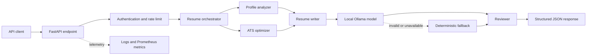

# Enterprise AI Resume Generator

[](https://github.com/AnkyAI/enterprise-ai-resume-agent/actions/workflows/ci.yml)
[](https://www.python.org/)
[](https://fastapi.tiangolo.com/)
[](https://ollama.com/)
[](LICENSE)

Enterprise AI Resume Generator is a secure, observable application programming interface (API) for producing structured, applicant tracking system (ATS) aligned resume content. Four specialized agents analyze the candidate, measure job alignment, write the resume, and review the result. A free local Ollama model handles generation, while a deterministic writer keeps the service available without a model.

## Project status

The current package version is `1.1.0`. The main branch passes linting, strict type checks, automated tests, coverage enforcement, and a production container build.

| Capability | Implementation |
|---|---|
| API framework | FastAPI with versioned routes and OpenAPI documentation |
| AI provider | Local Ollama with JSON Schema constrained output |
| Offline mode | Deterministic resume writer with no model dependency |
| Security | API keys, rate limits, body limits, strict validation, safe errors |
| Observability | JSON logs, request IDs, agent metrics, Prometheus endpoint |
| Delivery | Multi-stage Docker image, hardened Compose service, GitHub Actions |
| Quality | Ruff, strict MyPy, pytest, and 80% minimum coverage |

## How the pipeline works

Each request passes through a typed workflow. The orchestrator records every agent execution and returns one validated response.



The agents have separate responsibilities:

1. **Profile analyzer**: calculates experience, seniority, domain, and strengths
2. **ATS optimizer**: extracts role keywords, identifies gaps, and calculates alignment
3. **Resume writer**: generates summaries, bullets, skills, projects, and education
4. **Reviewer**: checks structure, consistency, professionalism, and ATS alignment

Read the [architecture guide](docs/ARCHITECTURE.md) for sequencing, scaling, and failure behavior. Read the [security guide](docs/SECURITY.md) for the threat model and production checklist.

## Run the API locally

You need Python 3.11 or newer. Ollama is optional because the deterministic provider works without it.

Create the environment and start the service:

```bash
python3.12 -m venv .venv
source .venv/bin/activate
python -m pip install -e '.[dev]'
cp .env.example .env
uvicorn resume_agent.api:app --reload
```

The API starts at `http://localhost:8000`. FastAPI serves interactive OpenAPI documentation at `http://localhost:8000/docs` in development.

Send the included sample profile:

```bash
curl --fail-with-body \
  -H 'Content-Type: application/json' \
  -H 'X-API-Key: dev-secret-key' \
  --data @examples/request.json \
  http://localhost:8000/v1/resumes/generate
```

An abbreviated response identifies the provider used and whether generation required the fallback:

```json
{
  "profile_analysis": {
    "candidate_level": "Mid-Level",
    "primary_domain": "Data Analytics Engineer",
    "years_experience": 3
  },
  "ats_analysis": {
    "ats_score": 68,
    "missing_keywords": ["stakeholder"]
  },
  "review": {
    "approved": true,
    "quality_score": 100
  },
  "metadata": {
    "ai_provider": "deterministic",
    "fallback_used": false
  }
}
```

## Enable free local AI generation

[Ollama](https://ollama.com/) runs open models on your machine without a paid API key. Install Ollama, download a model, and start its local service:

```bash
ollama pull llama3.2:3b
ollama serve
```

Configure the API through `.env`:

```dotenv
RESUME_AI_PROVIDER=ollama
RESUME_OLLAMA_MODEL=llama3.2:3b
RESUME_OLLAMA_BASE_URL=http://127.0.0.1:11434
RESUME_ALLOW_DETERMINISTIC_FALLBACK=true
```

The writer sends Ollama a JSON Schema generated from `ResumeContent`. The service validates the model output before the reviewer receives it. If the model is unavailable or returns invalid data, the deterministic writer runs and sets `fallback_used` to `true`.

For Docker Desktop with Ollama on the host, set `RESUME_OLLAMA_BASE_URL` to `http://host.docker.internal:11434`.

## API reference

The public operations endpoints support health checks and metrics. Resume generation requires the `X-API-Key` header.

| Method | Path | Authentication | Purpose |
|---|---|---:|---|
| `POST` | `/v1/resumes/generate` | Required | Execute the four-agent workflow |
| `GET` | `/health` | Public | Report process liveness |
| `GET` | `/ready` | Public | Report service readiness |
| `GET` | `/metrics` | Public | Export Prometheus metrics |

Restrict `/metrics` to your internal network at the production ingress.

## Configuration reference

All runtime settings use the `RESUME_` prefix. Start from `.env.example` and replace the development key before deployment.

| Variable | Default | Purpose |
|---|---|---|
| `RESUME_API_KEYS` | `dev-secret-key` | Comma-separated API keys |
| `RESUME_ENVIRONMENT` | `development` | Runtime environment and documentation policy |
| `RESUME_AI_PROVIDER` | `deterministic` | Select `deterministic` or `ollama` |
| `RESUME_OLLAMA_MODEL` | `llama3.2:3b` | Local generation model |
| `RESUME_OLLAMA_TIMEOUT_SECONDS` | `90` | Maximum model request duration |
| `RESUME_ALLOW_DETERMINISTIC_FALLBACK` | `true` | Preserve availability after model failure |
| `RESUME_RATE_LIMIT_REQUESTS` | `60` | Requests allowed per window |
| `RESUME_RATE_LIMIT_WINDOW_SECONDS` | `60` | Rate-limit window in seconds |

Production startup rejects the default development API key.

## Run with Docker

Docker Compose starts the API with a read-only root filesystem, no Linux capabilities, and a non-root user.

```bash
cp .env.example .env
docker compose up --build
```

Replace `RESUME_API_KEYS` in `.env` before setting `RESUME_ENVIRONMENT=production`.

## Verify the project

The local quality command matches the checks in GitHub Actions:

```bash
make check
```

The command runs:

- Ruff lint and formatting checks
- Strict MyPy analysis
- Pytest unit and API integration tests
- Coverage reporting with an 80% minimum in continuous integration

The CI workflow also builds the production Docker image.

## Repository structure

The source tree separates transport, orchestration, domain models, agents, providers, security, and telemetry.

```text
src/resume_agent/
├── agents/          # Isolated workflow responsibilities
├── providers/       # Ollama and future model adapters
├── api.py           # Routes, middleware, and error handling
├── config.py        # Validated environment configuration
├── models.py        # Request, response, and agent schemas
├── orchestrator.py  # Pipeline sequencing and provider fallback
├── security.py      # Authentication and rate limiting
└── metrics.py       # Prometheus instruments
tests/               # Unit and API integration tests
docs/                # Architecture and security decisions
examples/            # Sample generation request
```

## Security and privacy

Resume data contains personally identifiable information (PII). The service does not log request bodies, and local Ollama generation keeps candidate data on the host. A hosted deployment still requires transport encryption, secret management, access controls, retention limits, and applicable privacy review.

The generator must not invent employment, credentials, skills, or metrics. Missing ATS keywords are recommendations, not facts to insert. Human review remains required before using generated content.

## Current limitations

The reference implementation makes several deliberate tradeoffs:

- The in-memory rate limiter applies to one process and must be replaced for multiple replicas
- API keys suit a capstone deployment, while multi-tenant production requires OAuth 2.0 or OpenID Connect
- Local model quality and latency depend on the selected model and available hardware
- The API returns structured resume content rather than a rendered PDF or DOCX file

## Contribute

Read [CONTRIBUTING.md](CONTRIBUTING.md), create a focused branch, and run `make check` before opening a pull request. Security reports containing exploit details or candidate data should go to the repository owner privately.

## License

This project is available under the [MIT License](LICENSE).
