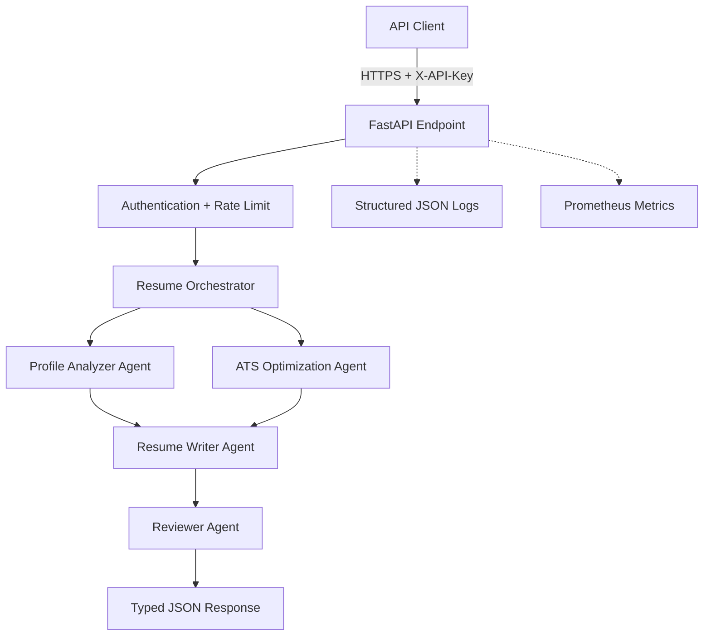

# Architecture

## System context

The endpoint and authentication boundary are separate from the workflow. Each agent accepts and returns validated domain models. The orchestrator owns sequencing, timing, and failure reporting; agents own one business responsibility.

## Request sequence

1. Middleware attaches a request ID, rejects oversized bodies, and records latency.
2. Authentication validates the API key using constant-time digest comparison.
3. The rate limiter enforces a per-key and per-client quota.
4. Pydantic rejects malformed or unexpected input before workflow execution.
5. The orchestrator runs profile analysis, ATS analysis, writing, and review.
6. The API serializes a strict response model and exposes operational telemetry.

## Scaling path

The local in-memory limiter is isolated behind one class. A multi-replica deployment should replace it with an atomic Redis limiter. Stateless agent execution can then scale horizontally behind a load balancer. Long-running provider calls can be moved to a queue while preserving the response schemas and agent contracts.

## AI provider boundary

The reference implementation is deterministic and offline so builds are reproducible and candidate data is not sent to a third party. Production teams can implement LLM-backed agents behind the same `Agent` interface. Provider adapters should add timeouts, retry budgets, model allowlists, output-schema validation, data-processing agreements, and prompt-injection defenses.

## Failure behavior

- Validation and authentication failures return safe, stable error envelopes.
- Unexpected failures are logged with a request ID while the client receives no stack trace.
- Agent executions and failures are counted independently.
- Candidate fields are never written to application logs.

